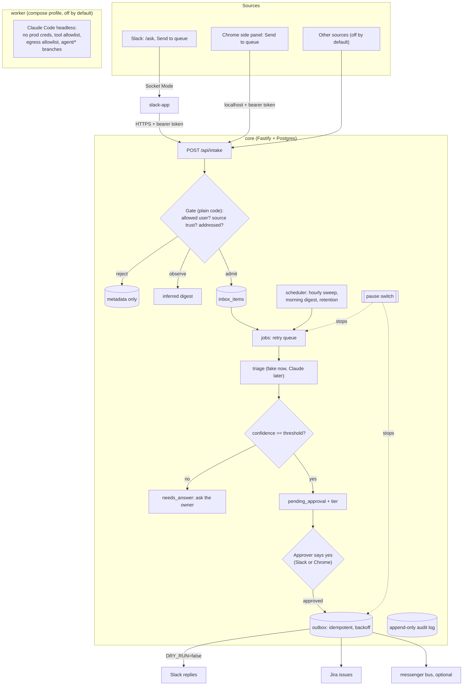

# agent-starter

A starter for a chief-of-staff agent system. People send requests from Slack and Chrome. A plain-code gate decides who gets in, a Postgres queue holds everything, and nothing is filed or sent until a person approves it.

- **Agents propose, people approve.** No auto-send, auto-merge or auto-delete.
- **Dry run by default.** Nothing reaches Slack, Jira or the bus until you set `DRY_RUN=false`.
- **One config file** (`agent.config.json`) says who it works for, who may approve, the Slack command, how much each source is trusted, the approval tiers and the skill packs.
- **Local first.** Docker Compose on your laptop, every port on 127.0.0.1, Slack in Socket Mode.
- **AI last.** Triage is a stubbed interface with a fake keyword implementation and an eval set, so the plumbing is proven before a model touches it.

MIT licensed. Node 24.

## How it fits together



Every intake, model call, decision and send also writes a row to the audit log. More detail in `docs/architecture.md`.

## Quickstart

Needs Docker and Node 24.

```sh
make setup up seed
```

That copies `.env.example` to `.env` and `context/person.template.md` to `context/me.md`, installs dependencies, starts Postgres, the core and the Slack app, and loads 20 synthetic requests. Then:

```sh
TOKEN=$(grep ^CORE_API_TOKEN .env | cut -d= -f2)
curl -s localhost:8787/health
curl -s -H "authorization: Bearer $TOKEN" localhost:8787/api/queue
make logs
```

The Slack app stays idle until you add its tokens. Everything else works with synthetic data straight away.

## Make it yours

Five steps for one person. `ADAPTING.md` covers a team, new sources and new skill packs.

1. **Secrets.** In `.env`, set `CORE_API_TOKEN` (`openssl rand -hex 32`) and `POSTGRES_PASSWORD`.
2. **Who it works for.** In `agent.config.json`, set `owner.name` and `owner.slackUserId` (Slack profile, the three dots, **Copy member ID**). Add approvers under `team.approverSlackUserIds`.
3. **Your command.** Set `slack.command` (default `/ask`) and `slack.appName`. Then `make slack-manifest` and create the Slack app from `packages/slack-app/manifest.generated.json` (steps below).
4. **Your context.** Fill in `context/me.md`: your role, the people who matter, what "urgent" means to you. It's git-ignored.
5. **What it may do.** Leave `approvalTiers` as they are for the first week. Pick your skill packs in `skillPacks` (`marketing` is the sample).

Restart after a config change: `docker compose restart core slack-app`. A bad config fails at startup with the field that's wrong.

## agent.config.json

- `owner.name`, `owner.slackUserId`: Who the agent works for. The owner can always send, approve and pause.
- `owner.contextFile`: Your per-person context file. Default `context/me.md`.
- `team.approverSlackUserIds`: Extra people who may approve, pause and resume.
- `team.allowedUsergroupId`: Slack user group whose members may send requests. Empty means owner only.
- `slack.command`, `slack.appName`, `slack.botDisplayName`: The slash command and names in Slack.
- `sources`: Trust per source: `explicit` (admitted when addressed), `inferred` (observe only) or `ignore`.
- `approvalTiers.jobs`: Tier per job: `read`, `draft` or `send_with_approval`. `automatic` is reserved and rejected.
- `approvalTiers.promoteAfterCorrectRuns`: Correct runs in a row before a person may promote a job. Default 5.
- `skillPacks`: Folders under `skills/packs/` to load. `core` is always on.

Secrets never go in this file. It's committed; `.env` is not.

## What's in it

- `packages/core`: the service. Fastify API, the gate, the inbox, a retry queue, the outbox for every outgoing write, a scheduler (hourly sweep, morning digest, retention), the audit log, the pause switch, and Jira and Confluence REST clients.
- `packages/slack-app`: Bolt app in Socket Mode. Your slash command, a "Send to queue" message shortcut, Approve and Reject buttons, and an App Home queue view with a pause button. Syncs the allowed user group into the gate.
- `packages/extension`: Chrome MV3 extension. Side panel with the queue and briefs, plus right-click "Send to queue". Talks to the core on localhost.
- `packages/shared`: types, the config schema, the core API client and Block Kit builders.
- `workers/claude-code`: a stub worker for Claude Code headless, with an egress allowlist proxy in `workers/egress`.
- `skills/`: the skill format, three core skills and a sample marketing pack.
- `context/person.template.md`: the per-person context file.
- `evals/triage`: 20 synthetic triage cases. `npm run eval` scores the current triage.
- `seed/`: synthetic seed data.

## Commands

- `make up`: start Postgres, core and the Slack app.
- `make down`: stop everything. Data is kept.
- `make seed`: load synthetic data. Safe to run twice.
- `make test`: unit tests. Postgres integration tests also run when `TEST_DATABASE_URL` is set.
- `make lint`: ESLint and the TypeScript typecheck.
- `make eval`: run the triage eval set.
- `make slack-manifest`: build the Slack manifest from `agent.config.json`.
- `make build-extension`: build the Chrome extension into `packages/extension/dist`.
- `make up-worker`: also start the sandboxed worker and its proxy.
- `make psql`: open psql on the local database.
- `make reset`: stop everything and delete the database volume.

## Create the Slack app

Socket Mode, so no public URL.

1. `make slack-manifest`.
2. Go to https://api.slack.com/apps, choose **Create New App**, then **From a manifest**, and pick your workspace.
3. Paste `packages/slack-app/manifest.generated.json`. Review the scopes, then create.
4. **Basic Information > App-Level Tokens**: make a token with the `connections:write` scope. Put the `xapp-...` value in `SLACK_APP_TOKEN`.
5. **Install App**: install it. Put the `xoxb-...` bot token in `SLACK_BOT_TOKEN`.
6. Optional: make a Slack user group for people allowed to send you requests. Put its ID in `team.allowedUsergroupId`.
7. `docker compose restart slack-app`. The log should say "Slack app connected (Socket Mode), listening for /ask".

Try `/ask review the pricing copy by Friday`, or **Send to queue** from any message's shortcut menu. The app's **Home** tab shows the queue.

If you change `slack.command` later, run `make slack-manifest` again and update the app's manifest in Slack.

## Load the Chrome extension

1. `make build-extension`.
2. Open `chrome://extensions`, turn on **Developer mode**, choose **Load unpacked**, and pick `packages/extension/dist`.
3. Open the extension's options and paste your `CORE_API_TOKEN`.
4. Click the toolbar icon for the side panel. Right-click a selection, link or page and choose **Send to queue**.

## Turn on Jira

1. Make a Jira service user with access to one project only, and an API token for it.
2. Set `JIRA_BASE_URL`, `JIRA_EMAIL`, `JIRA_API_TOKEN` and `JIRA_PROJECT_KEY` in `.env`.
3. Set `DRY_RUN=false` when you're ready for real tickets. Approved items become issues labeled `chief-of-staff`, and the requester gets "Filed as KEY-123".

## The worker

`make up-worker` builds and starts the worker and its egress proxy. With `WORKER_ENABLED=false` (the default) it checks its sandbox, prints the Claude Code command it would run, and exits.

- No production credentials. It refuses to start if it sees any.
- Egress only through `workers/egress/allowlist.txt`.
- Read-only root filesystem, all capabilities dropped, a non-root user.
- A git hook that only allows pushes to `agent/*` branches. Protect `main` on GitHub too.

## What's stubbed

- `ClaudeTriage` in `packages/core/src/triage/claude.ts`. Build it last, then `npm run eval`.
- `McpMessengerBus` in `packages/core/src/bus/index.ts`. See `docs/mcp-adapter.md`.
- Meeting briefs need a calendar source. The seed includes one sample brief.
- The worker's run and push steps.

## Before more than one person uses it

- A person id on every row with Postgres row-level security, so each person gets their own workspace.
- Secrets from a secrets manager instead of `.env`.
- An authenticated HTTPS endpoint for the Chrome extension instead of localhost.
- Retention set to what your security owner signs off (`RETENTION_DAYS`, `AUDIT_RETENTION_DAYS`).
- A signed security baseline. `SECURITY.md` is the starting point.

## Using this template

On GitHub, choose **Use this template** to make your own repo. Then turn on secret scanning and push protection, and protect `main` (require CI and a review).

## License

MIT. See `LICENSE`.
